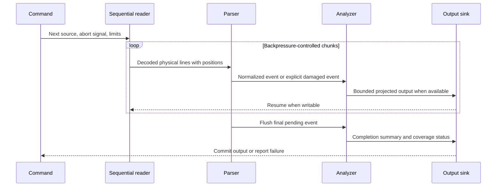

# Architecture

The restricted 2026-10-14 Windows experimental milestone is described in
[Windows acceptance](WINDOWS_BETA_ACCEPTANCE.md). Original multiplatform Stage 4
remains PARTIAL. Historical pathname descriptions below are superseded by native D19.

Stage 4 update (0.1.0-beta.1): production I/O now uses the packaged native backend,
not the historical pathname identity checks described below. See D19 and
[current acceptance](STAGE_4_ACCEPTANCE.md). Core/output schemas and the bounded
async pipeline are preserved. Windows is locally exercised; unverified Linux and
missing macOS output keep the release blocked.

Status: full-V1 implementation contract. Stage 1 implements contracts, the executable/CLI adapter, incremental input/framing, one-line parsing/normalization, inspection counters, protected summary rendering and safe sinks. Filtering, search, grouping, correlation, timeline and all report renderers are implemented in Stage 2; [acceptance](STAGE_2_ACCEPTANCE.md) records local evidence and outstanding reference gates. See [Stage 1 acceptance](STAGE_1_ACCEPTANCE.md).

Stage 3 hardening and actual residual safety failures are recorded in [AUDIT_REPORT](AUDIT_REPORT.md). Encoded gzip bounds, source-owned cancellation, scalar-growth reservation, lexical output protection and HTML preflight preserve these boundaries. Path identity checks do not provide atomic ancestor confinement; that unresolved policy violation blocks Stage 3 completion.

## Processing model

```mermaid
flowchart LR
  CLI[CLI entry and command routing] --> PLAN[Validated execution plan]
  PLAN --> IO[Source discovery and readers]
  IO --> FRAME[UTF-8 line framing]
  FRAME --> PARSE[Recognition and parsing]
  PARSE --> NORM[Canonical events]
  NORM --> FILTER[Filter and search predicates]
  FILTER --> ANALYZE[Counts, fingerprints, correlation]
  ANALYZE --> PROJECT[Redacted output projection]
  PROJECT --> RENDER[Text, JSON, NDJSON, Markdown, HTML]
  RENDER --> SINK[stdout or safe file sink]
  PLAN --> POLICY[Limits and cancellation]
  POLICY -.-> IO
  POLICY -.-> ANALYZE
  POLICY -.-> SINK
```

Search also sends canonical events through a bounded context window before projection. Group representatives are projected before retention; full raw records MUST NOT accumulate in aggregation maps. Summaries use counters, not retained event lists.

## Boundaries and responsibilities

Suggested directories are ownership boundaries, not a requirement for one file/class per responsibility.

| Area | Responsibility and dependency direction |
| --- | --- |
| `src/bin.ts` | Executable adapter; version/help, argument errors, signals, final exit selection; calls commands |
| `src/cli/` | Parse flags with Node standard library; validate command-specific options; construct immutable plan; calls core and I/O |
| `src/io/` | Discover explicit paths, validate/open sources, gzip streams, line framing, safe destination writes; depends on contracts and Node APIs |
| `src/core/` | Format recognition, parser state, normalization, pure predicates, fingerprints, bounded accumulators; depends only on contracts and permitted utility functions |
| `src/output/` | Redaction projection and format renderers; depends on contracts and security utilities; receives writers, never opens input |
| `src/contracts/` | Types, schema constants, error codes, shared limits; no command/I/O imports |

Dependency direction MUST be CLI → I/O/core/output → contracts. Core MUST NOT import CLI or renderers. Redaction may be a small shared pure module; no service container, general plugin registry, event bus, or repository layer is needed.

## Input and parsing

Discovery accepts only explicit inputs; it does not enumerate directories. Source order follows argument order. Readers open one source at a time, count compressed and decompressed bytes separately, and yield framed lines with byte and line positions. Format auto-detection is per record, not a whole-file guess. [PARSING_SPEC](PARSING_SPEC.md) owns precedence, continuation framing, and recovery. Parsing returns normalized events and diagnostics without printing.

Core accepts asynchronous iterables so tests can inject bounded synthetic streams. Reader errors are typed source outcomes. A source-local failure closes that reader, flushes safe incomplete evidence as specified, and permits the next source. Fatal sink/invariant failures cancel the entire operation.

## Analysis and output

Commands share normalization and filters. `inspect` counts; `search` matches and retains bounded context; `group` builds bounded fingerprints or explicit-ID buckets; `report` composes summary, error groups, identifier summaries, and time buckets. Algorithms and accuracy rules belong to [ANALYSIS_ENGINE](ANALYSIS_ENGINE.md).

All external strings pass through the output security projection, including examples, source labels, errors, and raw exports. JSON/NDJSON use stable schema envelopes; human renderers consume the same projections. HTML is static and script-free. Report construction MUST retain only bounded projected representatives and aggregation state; no reread or temporary full-input copy. JSON search uses a separately capped in-memory projected-results buffer to permit canonical envelope ordering; NDJSON/text search stream results directly.

## Errors, resource ownership, and portability

The command runner owns the abort controller, source lifecycle, limits, and final status. Counters and diagnostics flow as values, never hidden console effects. It MUST await close/cleanup and honor writable backpressure. [CLI_CONTRACT](CLI_CONTRACT.md) owns status precedence and machine records; [SECURITY_MODEL](SECURITY_MODEL.md) owns filesystem guarantees.

Node streams, filesystem APIs, URL-based ESM module resolution, and platform path utilities MUST replace shell-specific commands. Output line endings are LF on all platforms. Paths are treated as literal arguments, never interpolated into a shell. Pure algorithms plus injected streams make parser/analysis behavior testable without a terminal or real network. Extensibility means adding an explicit parser branch with fixtures and documented precedence, not loading executable plugins.
